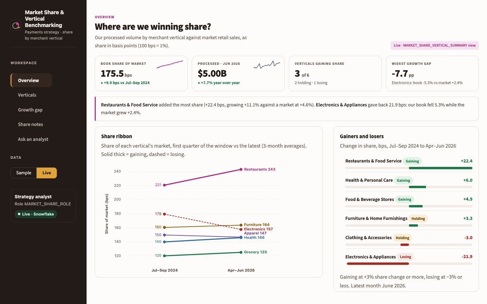

# Market Share & Vertical Benchmarking

Benchmark a payments processor's processed volume by merchant category against market retail sales, as market share in basis points with a year-over-year growth gap, and write a share note that a second AI pass fact-checks.

Owner: Javier Soliz · Last reviewed: November 2026

**Guide:** https://sfc-gh-jsoliz.github.io/sfguide-market-share-benchmarking/ · **Try it, no account:** https://sfc-gh-jsoliz.github.io/sfguide-market-share-benchmarking/try/



## What it shows

A strategy or benchmarking team at a processor wants to know where it is gaining or losing share by merchant vertical, not just whether its own volume grows. The app has five screens:

| Screen | What you see | Snowflake capability |
|---|---|---|
| Overview | Book share in bps, processed volume, verticals gaining share, widest growth gap; the share ribbon (slope chart, start vs now); gainers and losers | `MARKET_SHARE_VERTICAL_SUMMARY` view |
| Verticals | Sortable, filterable table with status pills; per-vertical share history, indexed growth and monthly figures | `MARKET_SHARE_BENCHMARK` view (window functions) |
| Growth gap | Our YoY growth minus the market's, per vertical and month, with a quadrant read-out | `growth_gap_pp` in the benchmark view |
| Share notes | A grounded note for the whole book or one vertical, badged **Verified** or **Needs review**, with its fact pack as sources; a gallery of saved notes | Cortex `AI_COMPLETE` (draft + verifier), `MARKET_SHARE_REPORTS` |
| Ask an analyst | Plain-English questions answered from SQL, with the SQL and result rows | Cortex Agent `MARKET_SHARE_AGENT` with Cortex Analyst over the `MARKET_SHARE_SV` semantic view |

Planted stories on this synthetic data set (see [data/README.md](data/README.md)): Restaurants gains 22.4 bps and Electronics loses 21.9 bps; Health and Grocery gain; Furniture and Apparel hold.

## How it works

- `MARKET_SHARE_BENCHMARK` joins the processor's monthly processed volume to market retail sales by category: `share_bps = processed_volume / market_sales x 10,000`, YoY growth of each with `LAG(..., 12)`, and the growth gap in percentage points. `MARKET_SHARE_VERTICAL_SUMMARY` compares 3-month average share at the start and end of the window and sets the status (Gaining at +3% or more, Losing at -3% or less).
- **Share notes:** the app builds a fact pack of pre-formatted figures from the summary view, `AI_COMPLETE` (`claude-sonnet-4-5`) drafts the note under strict data rules, and a second `AI_COMPLETE` pass compares every figure with the fact pack. The verdict and flagged claims are saved with the note.
- **Ask an analyst:** the app calls the Cortex Agent with `SNOWFLAKE.CORTEX.DATA_AGENT_RUN`; the agent uses Cortex Analyst over the semantic view to write and run SQL.
- **Sample mode** reads the same seeded rows from `app/sample/` and computes the same numbers as the views; AI responses are replayed from Live runs after a 4 to 8 s staged wait and labeled *Sample AI response*. **Live mode** never falls back to sample data: a failed query shows its error.

## Prerequisites

- A Snowflake account (Standard edition or higher) in a region where Cortex `AI_COMPLETE` with `claude-sonnet-4-5`, Cortex Analyst and Cortex Agents are available, or with cross-region inference enabled.
- A user who can use `ACCOUNTADMIN` once, to create the pack role `MARKET_SHARE_ROLE`; everything else runs as that role (`CREATE DATABASE`, `CREATE WAREHOUSE`, `SNOWFLAKE.CORTEX_USER`).
- For local Live mode: Python 3.11 or 3.12 and a key pair registered on your Snowflake user.
- Tested November 2026 with Streamlit 1.50.0, snowflake-snowpark-python 1.x, in Chromium (via Playwright).

## Run it

### Sample mode (no account)

Open the [hosted example](https://sfc-gh-jsoliz.github.io/sfguide-market-share-benchmarking/try/), or run the Streamlit app locally:

```bash
pip install -r app/requirements.txt
streamlit run app/streamlit_app.py
```

### Run it live

1. In a Snowsight worksheet, run [`sql/setup.sql`](sql/setup.sql) top to bottom (about 15 s on XSMALL; re-runnable).
2. Optional: get the free **Financial Data Package** Marketplace listing and run [`sql/setup_census.sql`](sql/setup_census.sql) to benchmark against US Census Advance Retail Sales instead of the synthetic market. Re-run `sql/setup.sql` to go back.
3. Start the app with key-pair auth and pick **Live** in the sidebar:

```bash
export SNOWFLAKE_ACCOUNT=<org-account>
export SNOWFLAKE_USER=<YOUR_USER>
export SNOWFLAKE_PRIVATE_KEY_PATH=~/.snowflake/keys/<your_key>.p8
streamlit run app/streamlit_app.py
```

### Deploy the app in Snowflake

Upload the `app/` folder (including `views/`, `sample/`, `environment.yml` and `.streamlit/config.toml`) to `@SNOWPACK_MARKET_SHARE.CORE.APP_STAGE/app`, then as `MARKET_SHARE_ROLE`:

```sql
CREATE STREAMLIT SNOWPACK_MARKET_SHARE.CORE.MARKET_SHARE_APP
  FROM '@SNOWPACK_MARKET_SHARE.CORE.APP_STAGE/app'
  MAIN_FILE = 'streamlit_app.py'
  QUERY_WAREHOUSE = SNOWPACK_MARKET_SHARE_WH
  RUNTIME_NAME = 'SYSTEM$WAREHOUSE_RUNTIME';
```

The app uses its own session there. Keeping it in this schema means `sql/cleanup.sql` removes it with the database. (The local Live path was verified in this build; the in-Snowflake deploy was not.)

### Explore the notebook

[`notebook/lab-market-share.ipynb`](notebook/lab-market-share.ipynb) walks through the benchmark, the semantic view, the fact pack, the draft and the verifier step by step.

## Objects created

| Object | Type | Purpose |
|---|---|---|
| `MARKET_SHARE_ROLE` | Role | Pack role; owns everything below |
| `SNOWPACK_MARKET_SHARE_WH` | Warehouse (XSMALL, auto-suspend 60 s) | Dedicated compute |
| `SNOWPACK_MARKET_SHARE.CORE` | Database and schema | Home for the pack |
| `MARKET_SHARE_MERCHANT_CATEGORY` | Table | Six MCC-aligned categories mapped to Census variable codes |
| `MARKET_SHARE_PORTFOLIO_MONTHLY` | Table | Synthetic processed volume by category and month |
| `MARKET_SHARE_RETAIL_SALES` | Table (view after `setup_census.sql`) | Market retail sales by category and month |
| `MARKET_SHARE_BENCHMARK` | View | Share in bps, YoY growth, growth gap |
| `MARKET_SHARE_VERTICAL_SUMMARY` | View | Start vs now share, change, status per vertical |
| `MARKET_SHARE_DATA_SOURCE_INFO` | View | Synthetic or Census market marker |
| `MARKET_SHARE_SV` | Semantic view | Business meaning for Cortex Analyst |
| `MARKET_SHARE_AGENT` | Cortex Agent | Answers questions in the app and in Snowsight |
| `MARKET_SHARE_REPORTS` | Table | Saved notes with verdict, flagged claims, fact pack, latency |
| `APP_STAGE` | Stage | Optional Streamlit in Snowflake deploy |

## Cost and time

- Setup: about 15 s on XSMALL. With the 60 s minimum per resume, a setup run plus a session of clicking around uses well under 0.1 warehouse credit (estimated from measured warehouse time; metering lags by hours).
- Each share note is two `AI_COMPLETE` calls (6 to 12 s in total, measured); each question is one Cortex Agent call (14 to 26 s, measured). Both bill by tokens at the rates in the Snowflake Service Consumption Table. The 7 notes and 4 answers captured for Sample mode were the AI spend for this build.

## Customize with Cortex Code

- "Explain this pack's data model and map `MARKET_SHARE_PORTFOLIO_MONTHLY` to my settlement tables without changing any objects. Propose least-privilege grants and a validation plan first."
- "Add Sporting Goods and Building Materials to `MARKET_SHARE_MERCHANT_CATEGORY`, map them to the right US Census variable codes, extend `data/generate.py`, and check the Overview, Verticals and Growth gap screens in Sample and Live mode."
- "Change the Gaining/Losing thresholds in `MARKET_SHARE_VERTICAL_SUMMARY` from 3% to a bps rule, update the Sample computation in `app/data.py` to match, and show me which verticals change status."

## Known limitations

- The processor's book is synthetic in both modes; there is no public source for a specific acquirer's volume. The market side is synthetic unless you run `sql/setup_census.sql`, which was not re-verified in this build (the listing was not mounted in the test account).
- Category and month granularity only: no metro, merchant or SKU detail.
- The verifier is itself a model. It catches figures that don't match the fact pack (one of the seven captured notes is flagged Needs review for a claim the facts don't support), but it is not a guarantee.
- The hosted example and Sample mode replay captured AI responses for the suggested scopes and questions only; free-text questions need Live mode.
- No dark mode.

## Cleanup

Run [`sql/cleanup.sql`](sql/cleanup.sql). It drops the database (and with it the agent, semantic view, stage and any Streamlit app), the warehouse and the role, then lists anything left with `SHOW` commands. It does not touch the Marketplace listing.

## Learn more

- [Cortex AI functions (`AI_COMPLETE`)](https://docs.snowflake.com/en/user-guide/snowflake-cortex/aisql)
- [Cortex Agents](https://docs.snowflake.com/en/user-guide/snowflake-cortex/cortex-agents)
- [Cortex Analyst](https://docs.snowflake.com/en/user-guide/snowflake-cortex/cortex-analyst)
- [Semantic views](https://docs.snowflake.com/en/user-guide/views-semantic/overview)
- [Streamlit in Snowflake](https://docs.snowflake.com/en/developer-guide/streamlit/about-streamlit)

## License

Apache 2.0 (see [`LICENSE`](LICENSE)). Illustrative example provided as-is, not an official Snowflake product and not supported by Snowflake Support. Synthetic data only; not financial, regulatory or compliance advice. Review and test before any production use.
